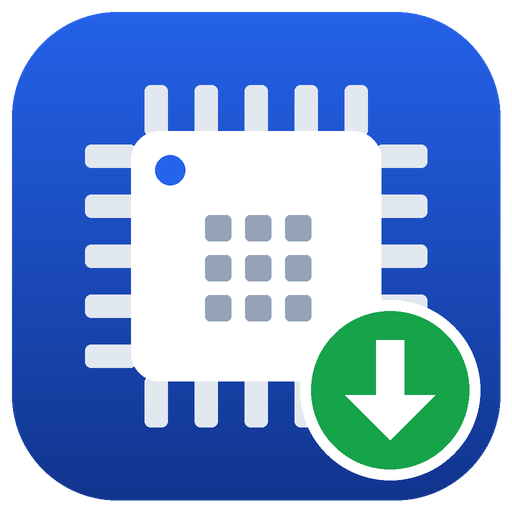
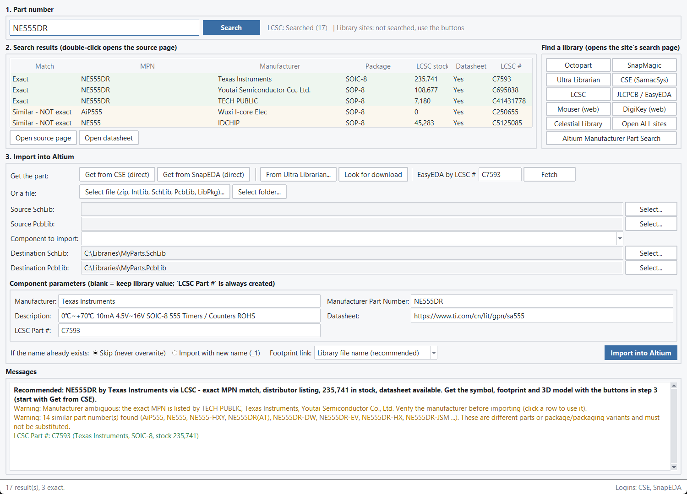

# Altium Library Manager

> **Rust migration in progress:** The GTK4 interface supports LCSC search and
> manual library-site links, selecting SchLib/PcbLib files or ZIP packages, and
> listing and selecting schematic components. CSE and SnapEDA direct downloads,
> EasyEDA conversion and staging, download watching, and IntLib extraction have
> been ported but not verified live.
> CSE and SnapEDA credentials are entered for each download and are not saved. The watcher
> loads a completed library for review rather than importing automatically;
> `.epw` downloads are not supported yet. Import has backups but has **not yet
> been verified end-to-end with Altium**; test only with copies.
> The workflow below describes the earlier Python version.

**Put any electronic part into your own Altium library in a few clicks:** symbol, footprint and 3D model, linked together and ready to place.

You type the part number (for example `RP2040` or `NE555DR`), click one button, and the app does the rest:
- it downloads the part from a free library website;
- it copies the symbol and footprint into **your own** `.SchLib` and `.PcbLib`;
- it links the footprint to the symbol and attaches the 3D model;
- it fills in Manufacturer, Part Number, Datasheet and LCSC number;
- it backs up your libraries first and never overwrites a part you already have.

It is free and open source (MIT licence). It works with **Altium Designer on Windows 10 and 11**. The single-file Rust package contains the GTK runtime.

---

## Contents
1. [What you need](#1-what-you-need)
2. [Download and start](#2-download-and-start)
3. [First-time setup (5 minutes, once)](#3-first-time-setup-5-minutes-once)
4. [Your first part, step by step](#4-your-first-part-step-by-step)
5. [Which button should I use?](#5-which-button-should-i-use)
6. [What happens when you import](#6-what-happens-when-you-import)
7. [Undo an import](#7-undo-an-import)
8. [Troubleshooting](#8-troubleshooting)
9. [Questions](#9-questions)

---

## 1. What you need

- A Windows 10 or 11 PC with **Altium Designer** installed.
- Your own **symbol library** (`.SchLib`) and **footprint library** (`.PcbLib`), the files you want new parts to go into. If you don't have them yet, create them in Altium: **File → New → Library → Schematic Library**, then **PCB Library**, and save both.
- A free account on **Component Search Engine**, the recommended source for symbol, footprint and 3D. Accounts on SnapEDA and Ultra Librarian are optional extras.

## 2. Download and start

The steps below describe the earlier Python release. For the Rust version, build
the single-file package described under [Run from source](#run-from-source-for-developers)
and run `AltiumLibraryManager.exe`. It extracts its runtime to a temporary
directory on startup and normally removes it when the application closes. An
interrupted process may leave a temporary `altium-library-manager-*` directory.
The executable produced directly by `cargo build` is not the single-file package.

1. Open the **[Releases page](https://github.com/Shihabul-glitch/Altium_Library_Mangement/releases/latest)** and download **`AltiumLibraryManager.exe`**.
2. Put it anywhere you like, for example on your Desktop, and **double-click it**.
3. **The first time, Windows may say "Windows protected your PC".** This happens because the app is free and not signed with a paid certificate. Click **More info**, then **Run anyway**. Windows remembers this.
4. **Start Altium Designer.** The app works through Altium, so Altium must be running when you import. If it isn't, the app offers to start it.

> **Tip:** for your first few imports, use **copies** of your libraries. The app always makes a backup and never overwrites existing parts, but trying it on copies first is a good habit.

## 3. First-time setup (5 minutes, once)

The app remembers all of this the next time you start it.

**Step A: choose where parts should go.**
In section **3. Import into Altium**, click **Select…** next to **Destination SchLib** and pick your symbol library. Do the same for **Destination PcbLib** with your footprint library.

**Step B: add your Component Search Engine login (recommended).**
1. Create a free account at [componentsearchengine.com](https://componentsearchengine.com/).
2. In the app, open **Settings → Component Search Engine…**.
3. Type your email and password, tick **Remember login**, and click **Sign in & test**. It should say "Signed in".

**Step C (optional): add your other logins.**
- **SnapEDA (Rust version):** create a free account at [snapeda.com](https://www.snapeda.com/). Enter the username and password when using the direct-download button; they are not saved.
- **Ultra Librarian:** create a free account at [ultralibrarian.com](https://www.ultralibrarian.com/), then go to **Settings → Ultra Librarian…**, enter your login (or click **Use my SnapEDA login** if it is the same) and click **Save**. The app uses it to copy your email and password into Ultra Librarian's sign-in page with one click.
You don't need any key for **Search**: it uses LCSC's parts catalogue, which needs no account.

The bottom-right corner of the window shows which logins are saved, for example *Logins: CSE, SnapEDA*.

**Are my passwords safe?** Logins are stored **encrypted with your Windows account** (Windows DPAPI). Only you, logged into your Windows account, can read them. They are never written into the app, a log, or this GitHub project. Each login is sent only to its own website. Untick **Remember login** to keep a login only until you close the app; **Log out** deletes it.

## 4. Your first part, step by step

1. In **1. Part number**, type or paste the manufacturer part number, for example `NE555DR`, and press **Search** (or Enter).
   - The app searches **LCSC's catalogue** (no account or key needed). The table shows each listing with its manufacturer, package, LCSC stock and LCSC number. A green row is an **exact** match of your part number; orange rows are similar but **different** parts.
   - The **Component parameters** fields fill in from the best exact match (the original manufacturer, most in stock): Manufacturer, Description, Datasheet and **LCSC Part #**.
2. Check that **Manufacturer** is right. Some part numbers are also made by other companies (clones). If Messages says "Manufacturer ambiguous", **click the row** of the manufacturer you want, and the fields and LCSC number switch to it. This field also decides which version the download buttons get.
3. In **3. Import into Altium**, click **Get from CSE (direct)**.
4. Wait a few seconds. The status line at the bottom shows the progress: searching, downloading, importing. If Altium shows a dialog, answer it.
5. When **Messages** shows **Import finished** in green, the part is in your libraries. In Altium, open the **Components** panel, find the part in your library, and place it.

That's it. If CSE doesn't have the part, Messages says so and suggests the next button to try.

## 5. Which button should I use?

All of these use the part number from **1. Part number**. Try them from top to bottom.

| Button | What you get | Login | How automatic |
|---|---|---|---|
| **Get from CSE (direct)** | Symbol, footprint, **3D** (placed correctly) | Component Search Engine | Fully automatic. **Start here.** |
| **Get from SnapEDA (direct)** | Symbol, footprint (typically **no 3D**) | SnapEDA | Downloads and selects a source for review |
| **From Ultra Librarian…** | Symbol, footprint, **3D** | Ultra Librarian (in your browser) | You click the download in your browser; the app imports it |
| **Look for download** | Whatever the file contains | None | Uses a library file you downloaded yourself, from any website |
| **EasyEDA by LCSC # → Fetch** | Symbol, footprint, 3D (community-made) | None | Builds staging libraries; then click **Import into Altium** |
| **Select file… / Select folder…** | Whatever the file contains | None | You pick the file; then click **Import into Altium** |

### Get from CSE (direct)
The app searches Component Search Engine for the **exact** part number, downloads the symbol, footprint and 3D model, and imports them. No browser is needed. If several manufacturers make that part number, the app uses the one in **Manufacturer**, or asks you to choose.

Only exact matches are used: `MCP23017-E/ML` and `MCP23017T-E/ML` are different parts. If there's no exact match, Messages lists the similar part numbers it found.

### Get from SnapEDA (direct)
Enter your SnapEDA credentials when prompted. The Rust version downloads and selects the source libraries; review them before clicking **Import into Altium**. This workflow has not been verified against the live service. SnapEDA's Altium downloads typically have **no 3D model**. If SnapEDA says "too many requests", wait about 10 minutes; SnapEDA limits how often you can sign in.

### From Ultra Librarian…
1. Click **From Ultra Librarian…**. Ultra Librarian opens in your browser with your part number already searched.
2. If the site asks you to sign in, click **Copy email** and **Copy password** in Messages and paste them in. Tick **Remember My Login** on the site so you stay signed in for about a month.
3. Open the part and click **Download Now**. Choose **Altium Designer** and **STEP**, accept the terms, tick **I'm not a robot**, and click **Download Now** again.
4. The app sees the downloaded `ul_<part>.zip` and **imports it automatically**, including the 3D model.

Ultra Librarian checks "I'm not a robot" before every download, so that one click happens in your browser. After a 3D model from Ultra Librarian is attached, check it once in Altium's 3D view (press **3** in the footprint editor), because Ultra Librarian doesn't say where its model should sit.

### Look for download
Use this for a library you downloaded yourself in your browser, from any website: Mouser's **ECAD Model** icon, Component Search Engine, SnapMagic, a manufacturer's website, and so on.
- **Downloaded already?** Click **Look for download**. The app looks in your Downloads folder for a library file (`.zip`, `.IntLib`, `.SchLib`, `.PcbLib` or `.LibPkg`) from the **last 30 minutes**. A file with your part number in its name is preferred and imported automatically. Any other file is loaded so you can check it first; then click **Import into Altium**.
- **Not downloaded yet?** Click **Look for download** first, then download. The app waits and picks up the file when it arrives. Click the button again to stop waiting.

The **Find a library** buttons on the right open each website's search for your part number; **Open ALL sites** opens them all at once.

### EasyEDA by LCSC #
For parts sold by LCSC and JLCPCB. When you **Search**, the app looks up the part's LCSC number (for example `C2040`) and fills it in for you. Click **Fetch**: the app downloads the EasyEDA data and builds the part in Altium. Then click **Import into Altium**. You can also type an LCSC number yourself.

The Rust converter is checked against the original offline fixtures, but fetching and building have not been verified live. The app builds new staging libraries and rejects a pad-count mismatch before selecting them. EasyEDA uses an undocumented API and community-made data; review converter warnings and always check the pinout, footprint, and 3D model against the datasheet.

### Not found anywhere? The Celestial Altium Library
The free [Celestial Altium Library](https://altiumlibrary.com/GetStarted) has about 250,000 parts with 3D models. It works **inside Altium** as a database library, so this app can't search it. Click the **Celestial Library** button for the setup guide: you create a free account, install their DbLib in Altium, and place parts from Altium's Components panel. Its licence allows commercial use in your designs, but not selling the symbols or footprints themselves.

## 6. What happens when you import

- **Backup first:** both destination libraries are copied to `%APPDATA%\AltiumLibraryManager\backups\<date-time>\`.
- **Copy and link:** the symbol and its footprint go into your libraries, and the footprint is **linked** to the symbol.
- **3D model:** a downloaded 3D model is attached to the footprint if the footprint doesn't already have one. For Component Search Engine parts, the app also gets the model's correct rotation and position.
- **Parameters:** `Manufacturer`, `Manufacturer Part Number`, `Description`, `Datasheet` and `LCSC Part #` are set. A field you leave empty keeps the library's own value.
- **Safety checks:** if the copied symbol or footprint doesn't match the original (pin count, pad count, objects), **nothing is saved**. The app also checks that every pin has a matching pad. This is an automatic check, so still compare the pinout with the datasheet.
- **Ready to place:** the app checks that Altium can find the new footprint right away, with no restart. Libraries you had open in Altium are closed during the import and reopened afterwards.

**If the part already exists:** with **Skip (never overwrite)**, the default, the existing part is left alone. With **Import with new name (_1)**, the new copy is added with a `_1` suffix. Existing parts are never replaced or deleted.

**Messages colours:** green = OK, orange = warning (read it), red = error (nothing was changed).

## 7. Undo an import

1. In Altium, close the destination libraries.
2. Open **Settings → Open data folder (backups, logs)** in the app, then the `backups` folder.
3. Open the folder with the date and time of the import, and copy the `.SchLib` and `.PcbLib` files back over your libraries.

You can also just delete the new symbol and footprint in Altium.

## 8. Troubleshooting

| Problem | What to do |
|---|---|
| Rust executable reports `gio-2.0-0.dll` or another GTK DLL is missing | Use the single-file Rust package, not the executable produced directly by `cargo build`. If using the folder bundle instead, keep all extracted files together. |
| Unpackaged Rust executable reports `VCRUNTIME140.dll` is missing | Use the single-file Rust package, or install the [Microsoft Visual C++ Redistributable](https://learn.microsoft.com/en-us/cpp/windows/latest-supported-vc-redist) matching the build architecture. |
| "Windows protected your PC" | Click **More info → Run anyway** (see [Download and start](#2-download-and-start)). |
| Antivirus warns about the .exe | Native Rust builds do not require a Python runtime. The full source code is here to check, or [run from source](#run-from-source-for-developers) instead. |
| "No answer from Altium" | Make sure Altium is running and no dialog box is open in Altium, then try again. |
| "A destination library is open in Altium with unsaved changes" | Save or close that library in Altium, then import again. |
| Altium says "footprint not found" when placing the part | Your destination PcbLib must be part of your open project or installed in Altium. Or choose **Footprint link: Full library path** before importing. If Messages says "library search does not find footprint", restart Altium once. |
| "Component Search Engine rejected the email/password" | Re-enter them in **Settings → Component Search Engine… → Sign in & test**. |
| SnapEDA says "too many requests" | Wait about 10 minutes, then try again. |
| A download is not picked up | **Look for download** and **From Ultra Librarian** watch your normal Downloads folder. If your browser saves somewhere else, set that folder in **Settings → Component Search Engine…**. |
| The 3D model is rotated or in the wrong place | Open the footprint in Altium, press **3**, and move or rotate the 3D body. CSE parts are placed automatically; this mostly affects other sources. |
| Search finds nothing, or says LCSC is not reachable | Check your internet connection. LCSC doesn't sell every part: if there's no exact match, you can still use the download buttons in step 3. They work with the part number alone. |
| The LCSC Part # stays empty | LCSC doesn't sell that exact part number, or lists it under another manufacturer. You can type the number yourself. |

**Your data** (settings, encrypted logins, backups, and the log file `alm.log`) lives in `%APPDATA%\AltiumLibraryManager\`. Open it with **Settings → Open data folder**. **To uninstall,** delete the app and that data folder.

## 9. Questions

**Does it change my existing parts?** No. It only adds new parts. It never replaces or deletes anything, and it backs up first.

**Do I need to install Python?** No. The Rust executable is native and does not use a Python runtime.

**Is it really free?** Yes, MIT licence, including commercial use. The library websites are free to use with a free account; their parts are subject to their own terms.

**Can I trust the downloaded footprints?** They come from well-known library providers, and the app checks the copy. Still, always check footprints and pinouts against the datasheet before ordering PCBs.

---

## Run from source (for developers)

- **Requirements:** Windows 10/11, Rust/Cargo, and GTK4 runtime/development libraries.
- **Start:** `cargo run`.
- **Tests:** `cargo test`.
- **Build:** `cargo build --release`. The native executable is in `target/release/altium-library-manager.exe` and opens without a console window on Windows.
- **Package the Windows Rust build as one x64 executable:** First run `cargo build --release` using the MSVC Rust toolchain and gvsbuild GTK. Then run `powershell -ExecutionPolicy Bypass -File tools\package-single-exe.ps1`. The script uses `C:\gtk` by default (override with `-GtkRoot`) and discovers the Visual Studio x64 C++ redistributable (or specify its `Microsoft.VC143.CRT` directory with `-VcRuntimeDir`). Pass `-AppExe` if the build is in a different location. It creates `dist\AltiumLibraryManager.exe` and refuses to overwrite an existing file. GTK, its data and license files, and the C++ runtime DLLs are embedded. This script expects a matching x64 gvsbuild layout and rejects binaries linked with a newer MSVC toolset than the redistributable.
- **Inspect or replace bundled libraries:** Run `Start-Process -Wait .\AltiumLibraryManager.exe -ArgumentList '--extract-runtime', 'C:\alm-runtime'` to extract the package to a new directory. The directory must not already exist. Third-party notices are in its `share\doc` and `share\licenses` directories; the extracted application can also be run directly with compatible replacement DLLs.
- **Optional folder bundle:** `powershell -ExecutionPolicy Bypass -File tools\package-windows.ps1` creates `dist\altium-library-manager` with the GTK runtime. The folder bundle does not include the C++ redistributable; distribute its entire contents and install the redistributable separately if needed.
- **Design notes:** see `architecture.md`, `progress.md`, `requirement.md` and `roadmap.md`. The Altium-side code is DelphiScript in `alm/altium/*.pas`; test changes on temporary libraries.

Contributions are welcome: fork the project, make your change, run the tests, and open a pull request.

## Credits and licence

- The Rust EasyEDA converter (`src/easyeda/convert.rs`) ports the original converter, and the part builder (`alm/altium/ee_build.pas`) comes from [EasyEDA-Importer](https://github.com/hiteshwar/EasyEDA-Importer), used with the owner's permission.
- The SnapEDA download method was learned from [datasheet-cli](https://github.com/akiselev/datasheet-cli) (GPL-3.0). No code was copied; `alm/snapeda_client.py` is an original implementation.
- Search and the LCSC number lookup use the LCSC/JLCPCB public parts catalogue, with LCSC's permission.
- Licensed under [MIT](LICENSE): free to use, copy, modify and share, including commercially, as long as you keep the licence notice. **No warranty.** Always check footprints and pinouts against the datasheet before ordering PCBs.
- Not affiliated with Altium, Mouser, SamacSys/Supplyframe (Component Search Engine), SnapEDA/SnapMagic, Ultra Librarian, EasyEDA, LCSC or JLCPCB. Library data from those sites is subject to their own terms.
